# Task Session 1: Multi-container Pods (Init Container & Sidecar)

This is my solution to Task Session 1 of the MLOps MENA Kubernetes course ([task description](https://github.com/MLOpsMENACommunity/Kubernetes-Course-Tasks/tree/master/task-session-1)).

An nginx "hello" page shows the current time. The Deployment runs 3 replicas. Each Pod has 3 containers and no volumes: an init container, the nginx container, and a sidecar that rewrites the page every 5 seconds. At the end I made the init container fail on purpose, watched how Kubernetes handled it, and then fixed it.

## Environment

The task assumes minikube. I used a kubeadm cluster instead, so the node names differ from the task's expected output.

| Item | Value |
|---|---|
| Cluster | kubeadm on 3 KVM VMs running Debian 13 |
| Nodes | `k8s-cp` (control plane), `k8s-w1`, `k8s-w2` (workers) |
| Kubernetes | v1.35.10 |
| Container runtime | containerd 1.7 |
| CNI | Calico v3.33.0 |
| Pod CIDR | 10.244.0.0/16 |

## Pod design

| Container | Type | Image | What it does |
|---|---|---|---|
| `init-done` | Init container | `busybox:1.36` | Prints `done` and exits. The other containers start only if it succeeds. |
| `nginx` | Main container | `nginx:1.27` | Writes the first `index.html` with the current time, then runs `nginx -g 'daemon off;'` on port 80. |
| `time-updater` | Sidecar | `busybox:1.36` | Every 5 s, finds the nginx PID with `pgrep -o nginx` and rewrites `index.html` through `/proc/<nginx-pid>/root/usr/share/nginx/html/index.html`. |

Because the Pod has no volume, the sidecar reaches the nginx filesystem in a different way:

- `shareProcessNamespace: true` in the Pod spec lets the sidecar see the nginx process.
- The `SYS_PTRACE` capability on `time-updater` lets it open `/proc/<pid>/root` of a process in another container.

Rollout strategy: `RollingUpdate` with `maxSurge: 1` and `maxUnavailable: 0`.

## Files

| File | Content |
|---|---|
| [`namespace.yaml`](namespace.yaml) | Namespace `webapp` |
| [`deployment.yaml`](deployment.yaml) | Deployment `web-deployment` (3 replicas, label `app: web`) |
| [`images/`](images/) | Screenshots |

While I worked, the Deployment file was named `web.yaml`. I renamed it to `deployment.yaml` afterwards, so some screenshots show `kubectl apply -f web.yaml`. It is the same file.

## Deploy

```bash
kubectl apply -f namespace.yaml
kubectl apply -f deployment.yaml
kubectl get pods -n webapp -w
kubectl port-forward -n webapp deploy/web-deployment 8081:80
```

I forwarded local port 8081 instead of 8080 (another service was running on 8080). Then I polled the page:

```bash
while true; do curl -s localhost:8081; echo; sleep 1; done
```

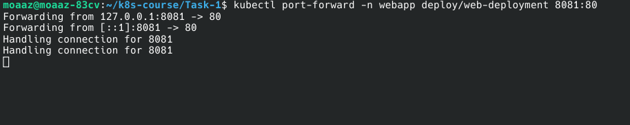

The time changes every 5 seconds:

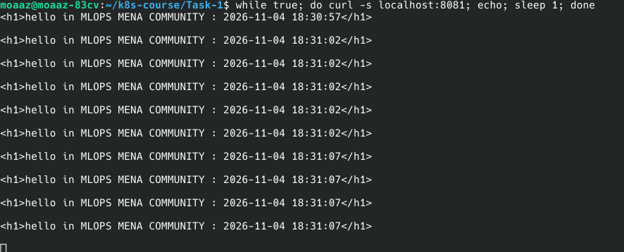

## Verification

I ran checks 1–8 one after another in one terminal (screenshot 01). Before running check 3, I had already applied the failing init container, so the `get pods` output at the end of screenshot 01 also serves as check 9.

| # | Check | Command | Result | Screenshot |
|---|---|---|---|---|
| 1 | 3 nodes | `kubectl get nodes` | `k8s-cp`, `k8s-w1`, `k8s-w2` are `Ready` | [01](images/01-verification-checks.png) |
| 2 | Deployment ready | `kubectl get deploy web-deployment -n webapp` | READY `3/3` | [01](images/01-verification-checks.png) |
| 3 | Pods running | `kubectl get pods -n webapp -l app=web` | 3 Pods `2/2 Running` (plus the failing Pod from step 5) | [01](images/01-verification-checks.png) |
| 4 | Containers | `kubectl get pods -n webapp -l app=web -o jsonpath='{.items[0].spec.initContainers[*].name} {.items[0].spec.containers[*].name}'` | `init-done nginx time-updater` | [01](images/01-verification-checks.png) |
| 5 | Init succeeded | `kubectl logs deploy/web-deployment -n webapp -c init-done` | `done` | [01](images/01-verification-checks.png) |
| 6 | Sidecar sees nginx | `kubectl exec deploy/web-deployment -n webapp -c time-updater -- ps` | `nginx: master process nginx -g daemon off;` in the list | [01](images/01-verification-checks.png) |
| 7 | Time updates | `kubectl exec deploy/web-deployment -n webapp -c nginx -- cat /usr/share/nginx/html/index.html` (3 times) | 18:37:28 → 18:37:33 → 18:37:38 | [01](images/01-verification-checks.png) |
| 8 | No volumes | `kubectl get deploy web-deployment -n webapp -o jsonpath='{.spec.template.spec.volumes}'` | Empty | [01](images/01-verification-checks.png) |
| 9 | Failing init | `kubectl get pods -n webapp -l app=web` | New Pod `0/2 Init:Error`, 2 restarts; the 3 old Pods stay `2/2 Running` | [01](images/01-verification-checks.png) |
| 10 | Init error details | `kubectl describe pod <new-pod> -n webapp` | `init-done`: `Exit Code: 1` | [04](images/04-failure-describe-1.png) |
| 11 | Fixed | `kubectl get deploy web-deployment -n webapp` | READY `3/3`, UP-TO-DATE `3` | [06](images/06-fix-deploy-ready.png) |

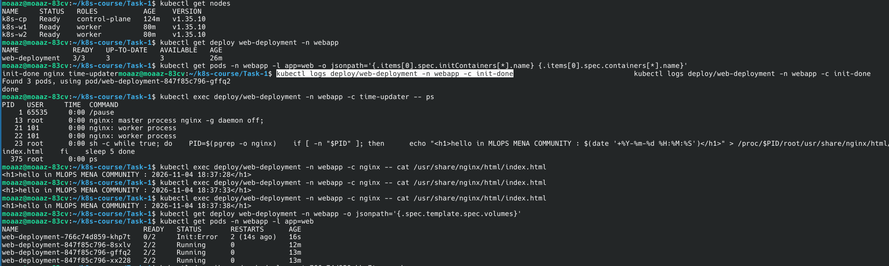

## Failure test

### What I changed

I changed only the init container command and re-applied the file without deleting the Deployment:

```yaml
command: ["sh", "-c", "echo 'init failed'; exit 1"]
```

### What happened

The new Pod went from `Init:Error` to `Init:CrashLoopBackOff` with READY `0/2`. The 3 old Pods stayed `2/2 Running`.

`kubectl describe` showed the following:

- `init-done` is `Terminated`, reason `Error`, `Exit Code: 1`, `Restart Count: 2`.
- `nginx` and `time-updater` are both `Waiting`, reason `PodInitializing`.
- The `Initialized` condition is `False`.
- Events show `BackOff`, restarting the failed container `init-done`.

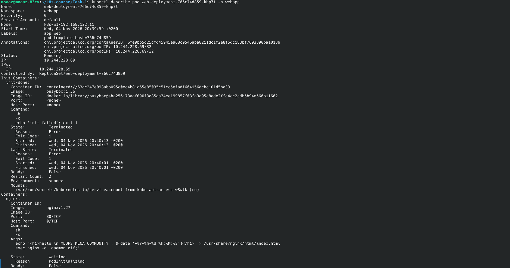

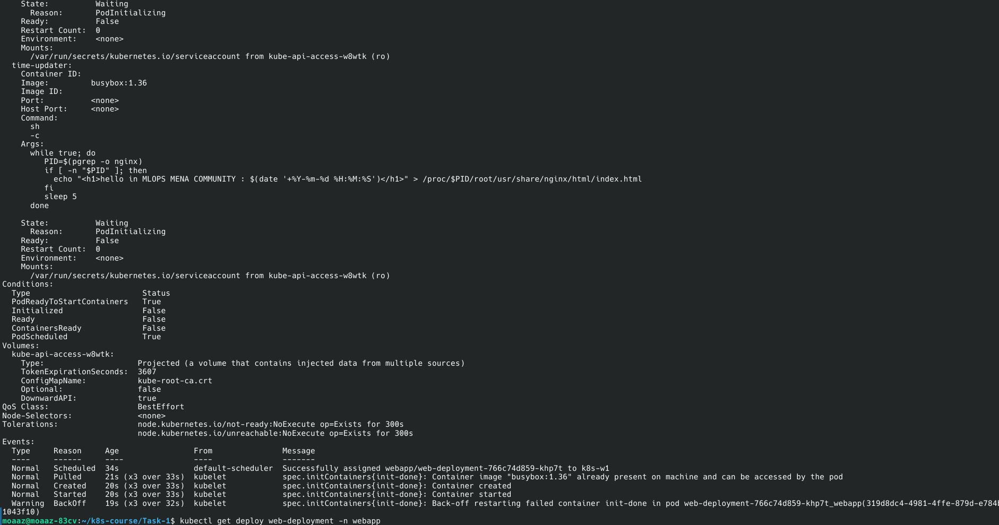

### Answers

**Which status does the new Pod show?**
The new Pod first shows `Init:Error`. After repeated restarts it shows `Init:CrashLoopBackOff`. READY is `0/2`.

**Do `nginx` and `time-updater` start, and why?**
No. Both stay `Waiting` with reason `PodInitializing`. Kubernetes starts a Pod's regular containers only after every init container has exited with code 0. `init-done` keeps exiting with code 1, so the kubelet keeps restarting it with back-off and never moves on to the regular containers.

**Is the page still reachable, and why?**
Yes. The 3 old Pods keep serving it, because of the rollout strategy:

- `maxUnavailable: 0`: the Deployment may not take down any old Pod until a new Pod is Ready to replace it.
- `maxSurge: 1`: the Deployment may create only one extra Pod above the 3 replicas.

The Deployment therefore created one new Pod from the new ReplicaSet and waited for it to become Ready. That Pod never becomes Ready, so the rollout stops there. The old ReplicaSet keeps all 3 Pods `2/2 Running`, and port-forward and any Service keep sending traffic to them. The failure stays contained in one extra Pod that never receives traffic.

## Fix

I put the working init command (`echo done`) back in `deployment.yaml` and re-applied the file. The Pod template then matches the old ReplicaSet again. The Deployment scaled the failing ReplicaSet down to 0, and the result was 3 running Pods.

```bash
kubectl apply -f deployment.yaml
kubectl get deploy web-deployment -n webapp
```

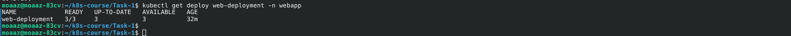

## Problems I hit

### 1. Pods stuck in `Init:0/1`: Calico plugin not found

**Symptom.** The first Pods stayed in `Init:0/1` for about 6 minutes. `kubectl describe` showed repeated `FailedCreatePodSandBox` events:

```
failed to find plugin "calico" in path [/usr/lib/cni]
```

**Cause.** Debian's containerd package looks for CNI plugins in `/usr/lib/cni`, but Calico installs them to `/opt/cni/bin`.

**Fix.** I changed `bin_dir` to the Calico path in `/etc/containerd/config.toml` on all nodes.

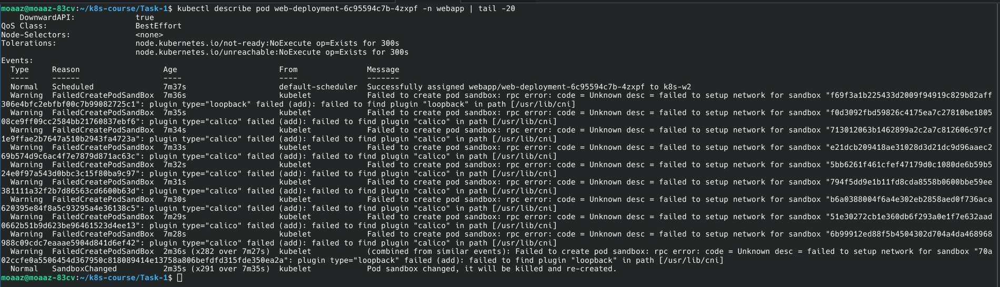

### 2. `ErrImagePull` / `ImagePullBackOff`

**Symptom.** Once the sandbox was created, the Pods hit `ErrImagePull` and then `ImagePullBackOff` at about 6m35s.

**Result.** About 30 seconds later, the kubelet's retry succeeded and all 3 Pods reached `2/2 Running` with 0 restarts. Screenshot 08 shows the whole sequence.

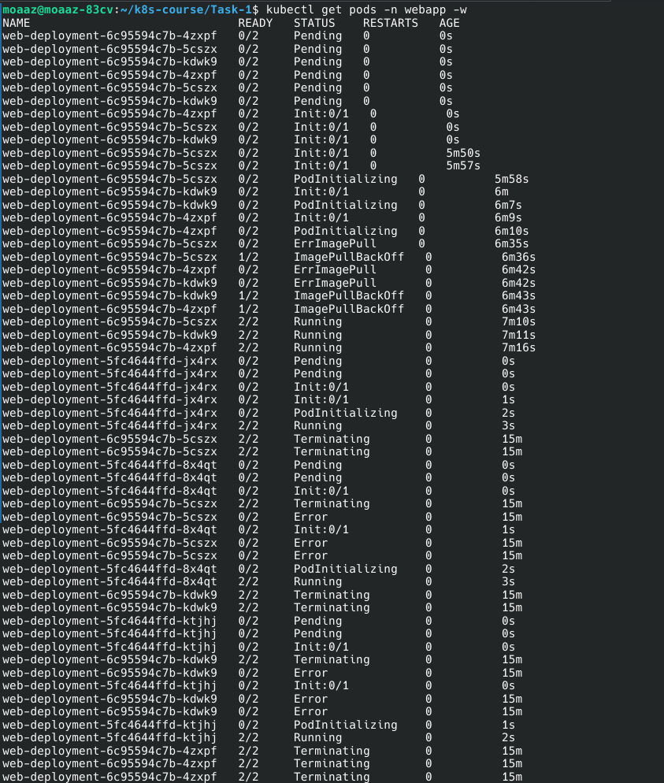

### 3. Sidecar: `sh: [-n: not found`

**Symptom.** The page time did not change.


**Cause.** The sidecar logs showed `sh: [-n: not found`. In the shell, `[` is a command, so it needs a space after it. `[-n` is read as a single command name, which does not exist.

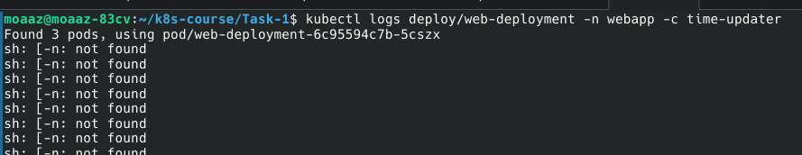

### 4. Sidecar: `sh: missing ]`

**Symptom.** After the first fix, the Pods were `2/2 Running`, but the sidecar logged `sh: missing ]`.

**Cause.** This was the same kind of spacing error: `]` must be a separate argument, with a space before it.

**Fix.** With `if [ -n "$PID" ]; then`, the logs are empty and the time updates.

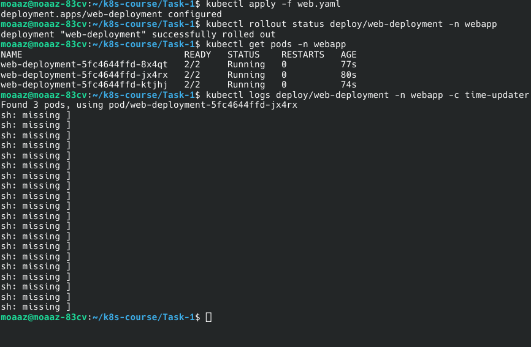

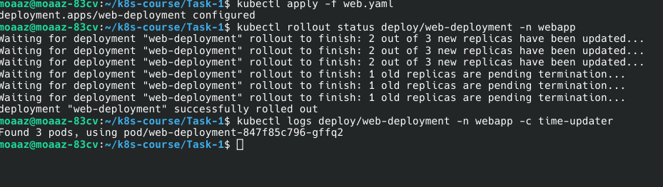

### 5. Old Pods show `Error` while terminating

**Symptom.** During each rollout, old Pods went from `Terminating` to `Error`.

**Cause.** On SIGTERM, the sidecar's `sh` loop exits with code 143 (128 + 15). A non-zero exit code is shown as `Error`.

**Impact.** None. The Pod was being deleted anyway.

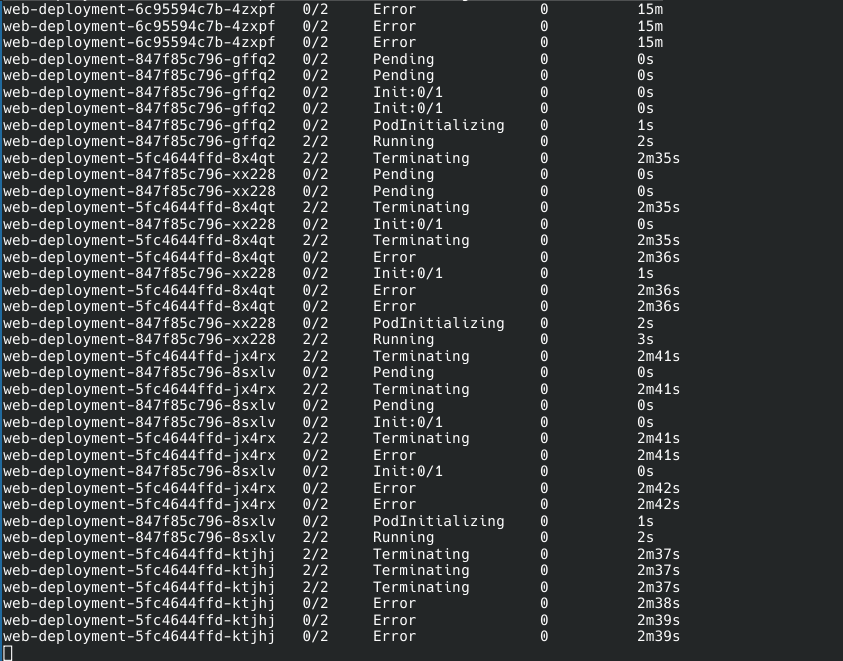
