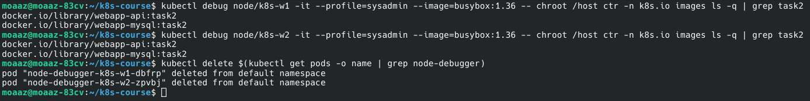
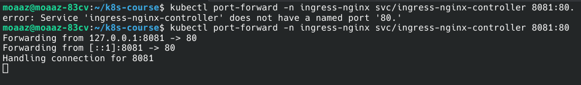
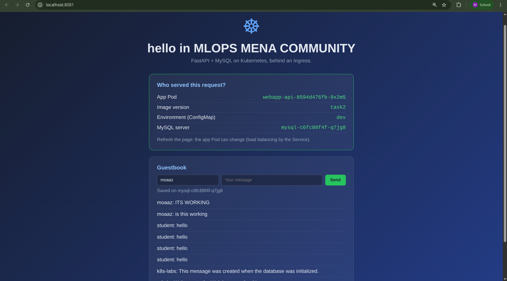
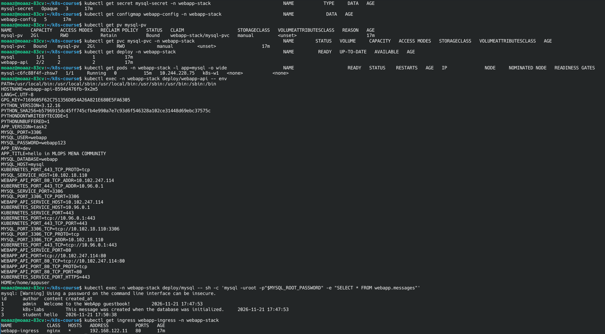
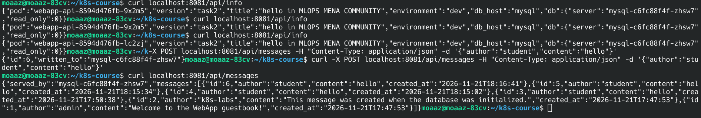
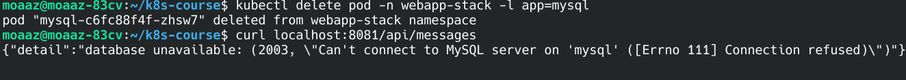
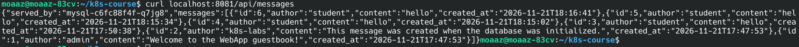

# Task Session 2: FastAPI + MySQL with ConfigMap, Secret & Ingress

This is my solution to Task Session 2 of the MLOps MENA Kubernetes course ([task description](https://github.com/MLOpsMENACommunity/Kubernetes-Course-Tasks/tree/master/task-session-2)).

A FastAPI guestbook app (2 replicas) stores messages in one MySQL server. MySQL keeps its data on a hostPath PV, the app settings are in a ConfigMap, the passwords are in a Secret, and the app is reached through an NGINX Ingress. At the end I deleted the MySQL Pod and checked that the messages were still there.

## Environment

Same cluster as Task 1, not minikube, so a few steps are different from the task.

| Item | Value |
|---|---|
| Cluster | kubeadm on 3 KVM VMs running Debian 13 |
| Nodes | `k8s-cp` (control plane), `k8s-w1`, `k8s-w2` (workers) |
| Kubernetes | v1.35.10 |
| Container runtime | containerd 1.7 |
| CNI | Calico v3.33.0 |
| Ingress controller | ingress-nginx v1.15.1 |

What I changed because of that:

- The task pins the PV to `minikube-m02`. My first worker is `k8s-w1`, so I pinned it there.
- There is no `minikube image load`, so I imported the images into containerd on both workers myself (step 1 below).
- No Helm and no minikube addon, so I installed ingress-nginx with its bare-metal manifest.
- Port 8080 is used by something else on my laptop, so I used 8081 like in Task 1.

## Files

| File | Content |
|---|---|
| [`namespace.yaml`](namespace.yaml) | Namespace `webapp-stack` |
| [`secret.yaml`](secret.yaml) | Secret `mysql-secret` |
| [`configmap.yaml`](configmap.yaml) | ConfigMap `webapp-config` |
| [`pv-pvc.yaml`](pv-pvc.yaml) | PV `mysql-pv` and PVC `mysql-pvc` |
| [`mysql.yaml`](mysql.yaml) | Deployment and Service `mysql` |
| [`webapp.yaml`](webapp.yaml) | Deployment and Service `webapp-api` |
| [`ingress.yaml`](ingress.yaml) | Ingress `webapp-ingress` |
| [`webapp/`](webapp/), [`mysql/`](mysql/) | The provided app and MySQL image, not changed |
| [`images/`](images/) | Screenshots |

## Deploy

### 1. Build the images and get them onto the workers

```bash
chmod -x mysql/initdb/01-setup.sh
docker build -t webapp-api:task2 ./webapp
docker build -t webapp-mysql:task2 ./mysql
docker save webapp-api:task2 webapp-mysql:task2 -o task2-images.tar
```

The kubelet takes images from each node's containerd, not from Docker on my laptop, so the tar has to be imported on every worker. My VMs only take password SSH, so I used `kubectl debug node` instead of scp. It runs a Pod on the node with the node's filesystem at `/host`:

```bash
for n in k8s-w1 k8s-w2; do
  kubectl debug node/$n --profile=sysadmin --image=busybox:1.36 -- sleep 3600
done
for p in $(kubectl get pods -o name | grep node-debugger | cut -d/ -f2); do
  kubectl cp task2-images.tar $p:/host/tmp/task2-images.tar
  kubectl exec $p -- chroot /host sh -c 'ctr -n k8s.io images import /tmp/task2-images.tar && rm /tmp/task2-images.tar'
done
kubectl delete $(kubectl get pods -o name | grep node-debugger)
```

The Deployments use `imagePullPolicy: IfNotPresent`, so the kubelet uses these images and doesn't try to pull them.



### 2. Apply the manifests

```bash
kubectl apply -f namespace.yaml
kubectl apply -f secret.yaml
kubectl apply -f configmap.yaml
kubectl apply -f pv-pvc.yaml
kubectl apply -f mysql.yaml
kubectl apply -f webapp.yaml
```

Some notes on the manifests:

- The PV has `nodeAffinity` to `k8s-w1`. hostPath is a folder on one node, so without this the MySQL Pod could start on `k8s-w2` and get an empty folder there.
- MySQL uses `strategy: Recreate`, so the old Pod is stopped before the new one starts and two MySQL servers never use the same files.
- The MySQL liveness probe waits 60 s, because the first start creates the database.
- `MYSQL_PORT` has to stay in the ConfigMap. Kubernetes also sets `MYSQL_PORT=tcp://<ip>:3306` for the `mysql` Service, and the app can't parse that. You can see these extra variables in screenshot 02.

### 3. Ingress controller and Ingress

```bash
kubectl apply -f https://raw.githubusercontent.com/kubernetes/ingress-nginx/controller-v1.15.1/deploy/static/provider/baremetal/deploy.yaml
kubectl get pods -n ingress-nginx
kubectl get ingressclass
kubectl apply -f ingress.yaml
kubectl port-forward -n ingress-nginx svc/ingress-nginx-controller 8081:80
```

My first port-forward failed because I typed `8081:80.` with a dot at the end. The second one worked:



The app at <http://localhost:8081>:



## Verification

I ran checks 2–8 one after another in one terminal (screenshot 02).

| # | Check | Command | Result | Screenshot |
|---|---|---|---|---|
| 1 | Images loaded | `kubectl debug node/<node> ... -- chroot /host ctr -n k8s.io images ls -q` | Both images on `k8s-w1` and `k8s-w2` | [01](images/01-images-loaded.png) |
| 2 | Secret and ConfigMap | `kubectl get secret mysql-secret -n webapp-stack`, `kubectl get configmap webapp-config -n webapp-stack` | DATA `3` and `5` | [02](images/02-verification-checks.png) |
| 3 | PV and PVC bound | `kubectl get pv mysql-pv`, `kubectl get pvc mysql-pvc -n webapp-stack` | Both `Bound`, `2Gi`, class `manual` | [02](images/02-verification-checks.png) |
| 4 | Deployments ready | `kubectl get deploy -n webapp-stack` | `mysql 1/1`, `webapp-api 2/2` | [02](images/02-verification-checks.png) |
| 5 | MySQL on the PV node | `kubectl get pods -n webapp-stack -l app=mysql -o wide` | `1/1 Running` on `k8s-w1` | [02](images/02-verification-checks.png) |
| 6 | App env | `kubectl exec -n webapp-stack deploy/webapp-api -- env` | `APP_TITLE`, `MYSQL_HOST=mysql`, `MYSQL_PORT=3306`, `MYSQL_USER`, `MYSQL_PASSWORD` | [02](images/02-verification-checks.png) |
| 7 | Default data | `kubectl exec -n webapp-stack deploy/mysql -- sh -c 'mysql -uroot -p"$MYSQL_ROOT_PASSWORD" -e "SELECT * FROM webapp.messages"'` | The 2 default messages, plus message 3 that I had posted before | [02](images/02-verification-checks.png) |
| 8 | Ingress | `kubectl get ingress webapp-ingress -n webapp-stack` | CLASS `nginx`, ADDRESS `192.168.122.11` | [02](images/02-verification-checks.png) |
| 9 | App info | `curl localhost:8081/api/info` | `version task2`, my title, `environment dev`; the `pod` changes between the 2 app Pods | [04](images/04-api-info-messages.png) |
| 10 | Write a message | `curl -X POST localhost:8081/api/messages -H "Content-Type: application/json" -d '{"author":"student","content":"hello"}'` | `{"id":6,"written_to":"mysql-c6fc88f4f-zhsw7"}` (ids 3–5 were my earlier tests) | [04](images/04-api-info-messages.png) |
| 11 | Read messages | `curl localhost:8081/api/messages` | My messages + the 2 default ones | [04](images/04-api-info-messages.png) |
| 12 | Data survives a restart | `kubectl delete pod -n webapp-stack -l app=mysql`, wait, check 11 again | Same messages, served by the new Pod | [07](images/07-problem-mysql-not-ready.png), [05](images/05-persistence.png) |





## Data persistence after a Pod restart

Before the restart, the messages were served by `mysql-c6fc88f4f-zhsw7` (screenshot 04). I deleted that Pod. My first curl came too early and failed (see problem 3 below):



When the new Pod was ready, all 6 messages were there, now served by `mysql-c6fc88f4f-q7jg8`:



The data is not inside the container. `/var/lib/mysql` is the PVC, which is the folder `/data/webapp-mysql` on `k8s-w1`. Deleting the Pod doesn't touch that folder, and because of the PV's `nodeAffinity` the new Pod started on `k8s-w1` again and found the same files. MySQL only runs its init scripts on an empty folder, and the new Pod's log has no `Creating database` line, so it used the existing database.

## Problems I hit

### 1. No SSH key access to the nodes

`ssh k8s-w1` gave `Permission denied (publickey,password)`, so I couldn't copy the image tar with scp. I used `kubectl debug node/<node> --profile=sysadmin` instead (step 1). It only needs kubectl access.

### 2. `crictl: not found`

I wanted to check the images with `crictl images`, but the Debian containerd package doesn't include crictl. `ctr -n k8s.io images ls` works. The `-n k8s.io` part is important: the kubelet only sees images in that containerd namespace.

### 3. `database unavailable` right after deleting the MySQL Pod

I ran the curl right after the delete and got `Can't connect to MySQL server on 'mysql' ... Connection refused`. With `Recreate` there is no MySQL at all for a few seconds: the old Pod is gone, and the new one isn't Ready yet, so the `mysql` Service has no endpoints. The app returns 503 for that time but keeps running. It worked once I waited for the Pod:

```bash
kubectl wait -n webapp-stack --for=condition=ready pod -l app=mysql --timeout=120s
```

### 4. PVC `Pending` for a few seconds

Right after applying `pv-pvc.yaml`, the PV was already `Bound` but the PVC still showed `Pending`. A few seconds later it was `Bound` too. The binding happens in the background, so this was nothing.
